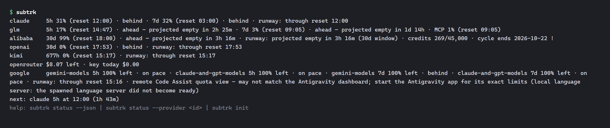
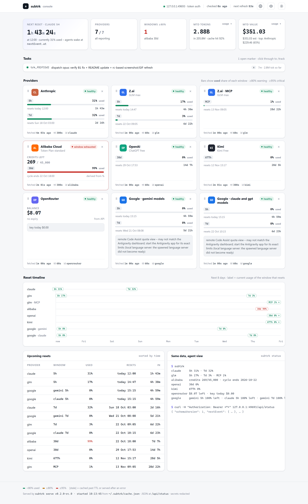
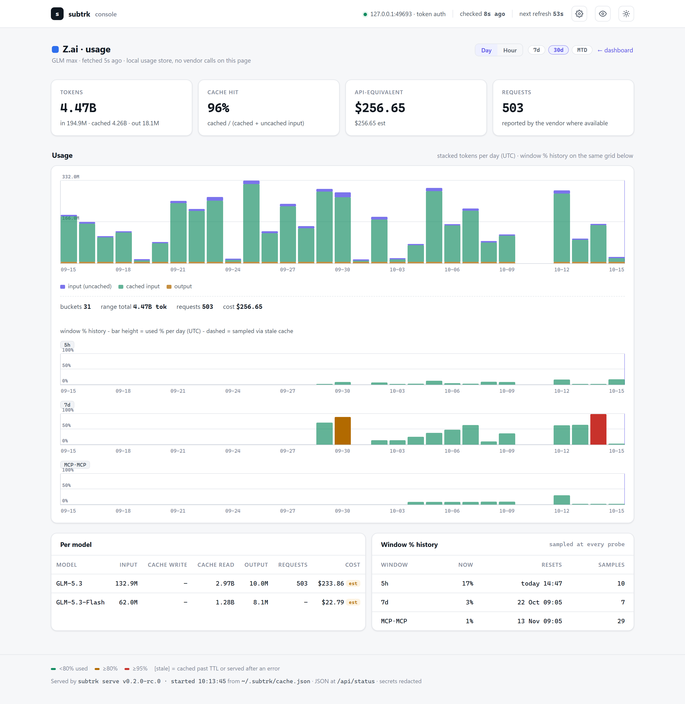
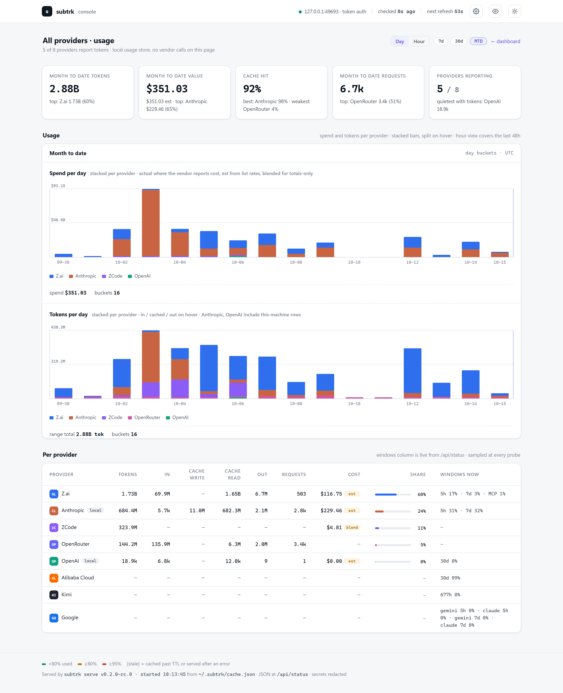
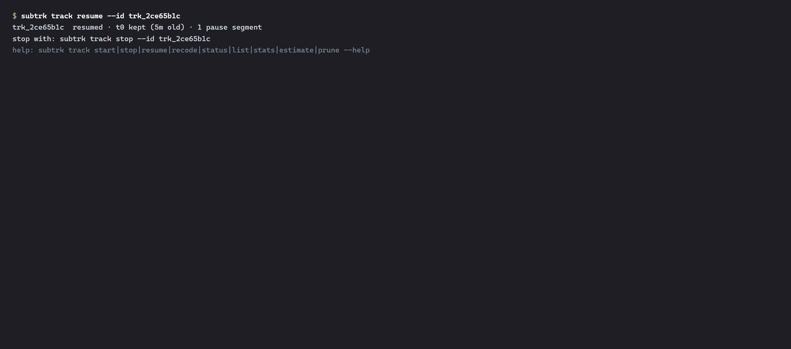
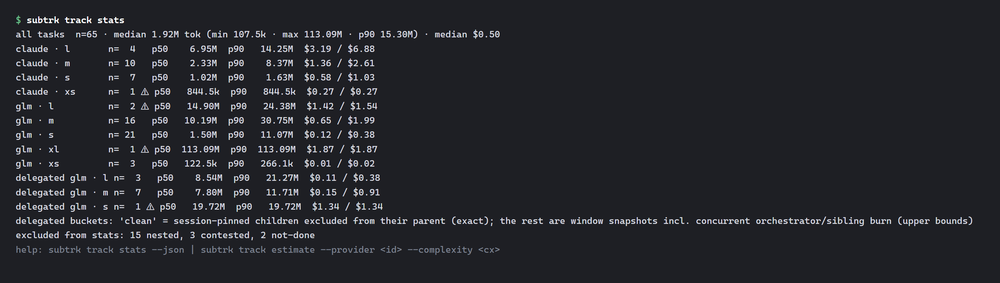
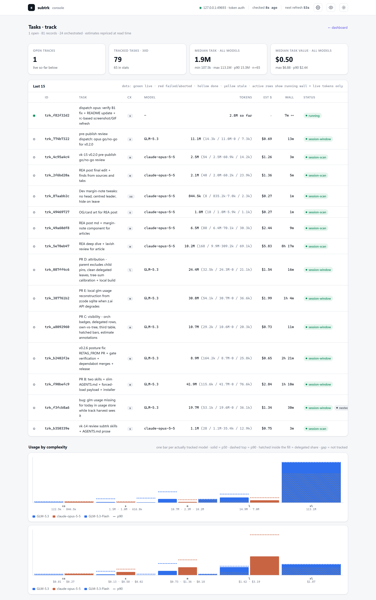
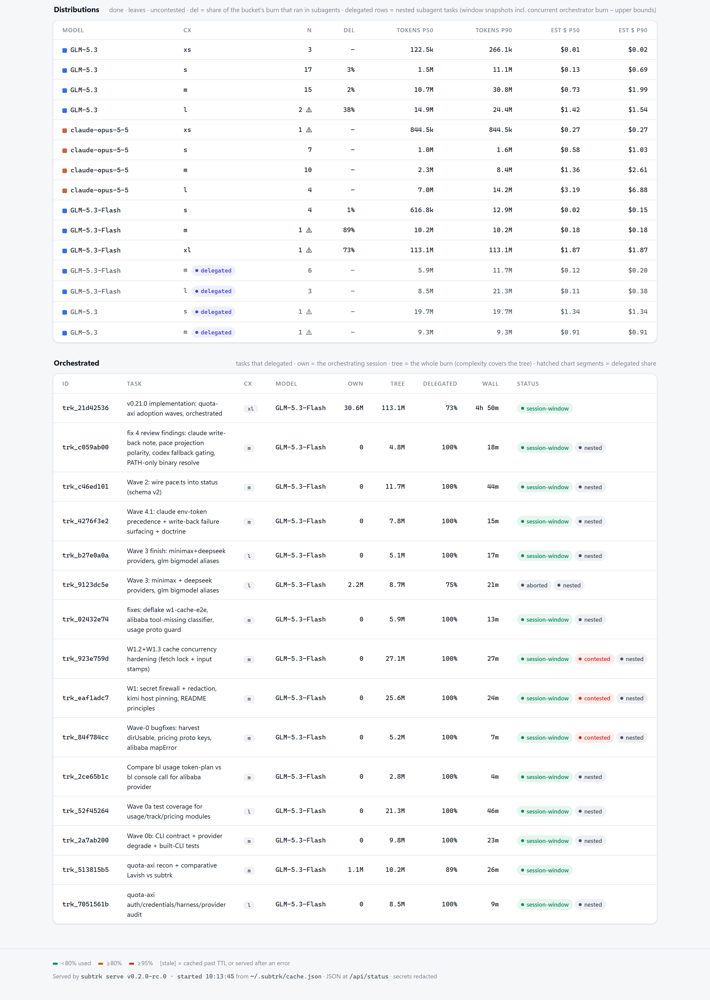

# subtrk

[](https://github.com/ChaosChild/subtrk/actions/workflows/ci.yml)
[](https://www.npmjs.com/package/subtrk)
[](https://github.com/ChaosChild/subtrk/blob/main/package.json)
[](LICENSE)
[](https://socket.dev/npm/package/subtrk)

**AI subscription quotas in one command.** `subtrk` reports remaining usage for
the plans its contributors use – today Claude Pro, Z.ai GLM Coding Plan, Alibaba
Cloud Model Studio, Google AI Pro, OpenCode Zen, OpenRouter, the ChatGPT plans
(via the OpenAI Codex CLI), the Kimi coding plans (via the Kimi Desktop app or
the Kimi Code CLI) and the z.ai Start Plan bundles (via the ZCode desktop app) –
in one compact view, designed first for the AI agents that work for you and
second for you.
Coverage expands as needs or requests come in: adding a provider is a contained
change (see the [implementation guide](docs/implementation-plan.md)), and PRs
adding providers are welcome.

Agents stop hitting brick walls at rate limits: `subtrk status --json` gives every
window's usage and reset time plus a computed `nextEvent`, so an agent can schedule a
wake-up at the reset instead of dying. Humans stop keeping a browser tab open per
provider. And because no API reports what a single task cost, `subtrk track`
measures it from the harnesses' own local stores – start, pause, resume, stop
with a reassessed complexity, recode later – and turns that history into
"does this task fit my remaining window?" estimates
([Task tracking](#task-tracking--what-did-this-task-cost)).

```text
$ subtrk
claude     5h 31% (reset 12:00) · behind · 7d 32% (reset 03:00) · behind · runway: through reset 12:00
glm        5h 17% (reset 14:47) · ahead – projected empty in 2h 25m · 7d 3% (reset 09:05) · ahead – projected empty in 1d 14h · MCP 1% (reset 09:05)
alibaba    30d 99% (reset 18:00) · ahead – projected empty in 3h 16m · runway: projected empty in 3h 16m (30d window) · credits 269/45,000 · cycle ends 2026-10-22 !
openai     30d 0% (reset 17:53) · behind · runway: through reset 17:53
openrouter $8.07 left · key today $0.00
next: claude 5h at 12:00 (1h 43m)
help: subtrk status --json | subtrk status --provider <id> | subtrk init
```



## Web console

```bash
subtrk serve
```

Starts the dashboard on a random `127.0.0.1` port and prints the URL to open –
one page for every tracked provider: usage bars per window (with ≥80%/≥95% warning
levels), credit pools, a 7-day reset timeline, upcoming resets, and the same
agent view the CLI prints, auto-refreshing on the cache heartbeat. The top row
carries month-to-date token and value cards (local calendar month) – both open
the all-providers usage page. A provider that reports several model classes
(Google's Gemini and Claude/GPT, for example) renders one card per class. When
a provider's error says it is refreshable, its card shows a **Refresh now**
button that re-runs that provider's own refresh action on the host. A gear-icon
menu in the header toggles providers on/off, an eye-icon menu shows or hides
individual cards, every card has an × to hide itself, and cards drag
individually into any order – all persist across restarts (saved to
`~/.subtrk/config.json`, like `subtrk init`).



Every card is clickable into that provider's **usage page** – the headline
addition of M3: a day/hour token chart with the provider's window-% history on
the same time grid, a per-model table with API-equivalent costs labeled
actual / est / blended, and the live windows, all served from the local usage
store with no vendor calls while you browse (details in
[Usage history](#usage-history)).



Both month-to-date cards open the **all-providers usage page** – the same
day/hour charts with every token-reporting provider stacked on one grid: an
API-equivalent spend chart (actual where the vendor reports cost, est from
list rates, blended for totals-only – each segment names its kind on hover),
a tokens chart, a facts row (top provider by tokens and by value, best and
weakest cache hit, quietest reporter, requests), and a per-provider table
with the live windows. Providers without a token surface keep their honest
dash row instead of fake zeros.



The server is loopback-only, requires a per-run token (delivered in the printed
URL), never emits CORS headers, and status stays read-only – toggles and card
order persist through the authenticated `POST /api/config` – see
[`docs/spec.md`](docs/spec.md) §`subtrk serve` for the security design.

## Why

Modern AI workstations juggle several subscriptions with different windows (5-hour,
weekly, monthly credit pools) and different dashboards. Without a combined view you
over-plan, under-use, and your agents discover limits by crashing into them. `subtrk`
reads each vendor's usage the same way their own CLIs do, normalizes it, caches it
politely, and speaks both human and agent.

## Design principles

- **Agents first** – follows the [AXI principles](https://axi.md): token-efficient
  output, pre-computed aggregates (`nextEvent`, `recheckAfter`), structured errors
  you branch on by kind (never by message text), exit codes with meaning, no
  interactive traps in agent paths, content before help.
- **Zero runtime dependencies** – TypeScript in the repository, executed
  directly by Node ≥22.18 (type stripping, no build step in development); the
  npm package ships compiled JavaScript (Node never type-strips under
  `node_modules`). The dev toolchain (typecheck, linter, compiler) is dev-only
  and never ships.
- **Polite by construction** – one shared TTL cache (`~/.subtrk/cache.json`) with
  stale-while-revalidate and a hard 300s floor on the one endpoint known to punish
  polling. Six agents checking simultaneously produce one upstream request.
- **Fail soft, per provider** – one broken endpoint never breaks the others; errors
  carry a `kind` and a `hint`, and stale cached numbers beat a wall of text.
- **Secrets stay put** – reads the credential files your CLIs already maintain
  (read-only), stores its own keys in `~/.subtrk/env` (never global env vars), and
  mechanically redacts every secret from every output. The cache contains no secrets.
- **Ported ideas credit their source** – a borrowed check or structure names its
  origin in-file (MIT attribution, e.g. quota-axi); the link between the idea and
  its upstream lives next to the code that carries it.
- **Output is add-only** – flags like `--fields`/`--json` may filter, and richer
  modes add detail, but a field's meaning never changes between modes: demotion
  happens in the renderer, never in the data.
- **Absent data stays absent** – a missing window, reset time, or percentage is
  never invented; if the wire carries `percentUsed`, `percentRemaining` is left
  out rather than derived.
- **Expiry is advisory** – a stored `expiresAt` only orders candidates; a
  credential is retired by the vendor endpoint's rejection, never by a clock.
- **Accounts don't mix** – identity is the vendor's `accountId`; windows from
  different accounts are never summed.

## Install

Requires Node ≥22.18.

No install needed – every command runs through npx:

```bash
npx subtrk init     # one-time interactive setup
npx subtrk serve    # web console
npx subtrk auth refresh --provider <id>   # re-authorise one provider (e.g. alibaba or google)
npx subtrk          # same as: npx subtrk status
```

Or install globally:

```bash
npm install -g subtrk
subtrk init       # one-time interactive setup
```

From source (development):

```bash
git clone https://github.com/ChaosChild/subtrk.git
cd subtrk
npm install       # dev-only toolchain
npm link          # puts `subtrk` on PATH (subtrk.cmd on Windows)
```

`subtrk init` first asks which providers you track – a numbered listing answered
with numbers and/or ids (e.g. `1 3 5` or `claude, google`) – and stores the
selection in `~/.subtrk/config.json`; the checks below then only cover those.
Edit the file or re-run `subtrk init` to change the selection, delete it to
track all of them again. It runs the Alibaba login flow (`bl auth login --api-key` +
`--console` browser login), prompts for OpenRouter keys (hidden input, saved to
`~/.subtrk/env`), and verifies each provider honestly – `[ok]` only when a
credential actually works.

### Agent instructions

`subtrk init --agent <harness>` appends a short marked section to a harness's
GLOBAL agent instructions file, so the agent knows how to call subtrk:

| harness | file |
|---|---|
| `claude` | `~/.claude/CLAUDE.md` (Claude Code global memory) |
| `zcode` | `~/.zcode/AGENTS.md` |
| `codex` | `~/.codex/AGENTS.md` |
| `opencode` | `~/.config/opencode/AGENTS.md` (this exact path on Windows too) |
| `agy` | `~/.gemini/AGENTS.md` (Antigravity; the path is `~/.gemini` by convention) |

The write is idempotent – re-running replaces only subtrk's block between the
`<!-- subtrk:begin -->` / `<!-- subtrk:end -->` markers and never touches
anything else; to remove it, delete the block between the markers.

The section comes in two tiers. The default is quota guidance only – some
users never want task tracking in their agents' instructions. Interactive
`subtrk init` asks once whether to teach it (default No, stored as
`agents.track` in `~/.subtrk/config.json`); `subtrk init --agent <harness>
--track` opts in explicitly, `--no-track` opts back out. Both tiers keep the
AGENTS.md/CLAUDE.md section SLIM – the detailed contracts live on demand in
skills, installed into each harness's skills dir:

| harness | skills dir |
|---|---|
| claude | `~/.claude/skills` |
| zcode | `~/.zcode/skills` |
| codex | `~/.codex/skills` |
| opencode | `~/.config/opencode/skills` |
| agy | `~/.gemini/config/skills` (IDE) and `~/.gemini/antigravity-cli/skills` (CLI) |

The `subtrk` skill (both tiers) carries the full quota/status contract; the
`subtrk-track` skill (track tier) carries the lifecycle playbook – ladder,
pause/resume, stop-time reassessment, subagent session pins. `init --agent`
writes/refreshes them idempotently and `--no-track` removes `subtrk-track`.

The track tier also registers lifecycle hooks in the harnesses that support
them – claude (`~/.claude/settings.json`), zcode (`~/.zcode/cli/config.json`)
and codex (`~/.codex/config.toml`) – so the harness itself reminds the agent
to run `track start`/`track stop` at session start and turn end (`subtrk
track hook` under the hood: read-only, throttled to once per session plus
open/paused-set changes, never blocks). Every hook entry subtrk writes carries the
literal `subtrk track hook` in its command; re-running with `--no-track`
removes exactly those and nothing else, and a JSON target gets a one-time
`.subtrk-bak` copy before its first modification. opencode and agy get
instructions only (agy hooks are documented but not yet wired). On any other
harness, paste the status body below into its instructions file manually
(without the markers – `subtrk init --agent` wraps it in them) and place the
skill bodies (`subtrk`, plus `subtrk-track` on the track tier) into its
skills dir – or inline them if it has none:

```markdown
## subtrk

`subtrk` reports remaining quota for the AI plans configured on this machine.
Run `subtrk status --json` before committing to large or long-running provider
work, when a provider fails with quota or rate-limit errors, and on wake-ups -
`nextEvent.at` (or `recheckAfter` when absent) says when new information can
exist, so schedule around it instead of polling. The full contract (windows,
error kinds and remedies, exit codes, cache etiquette) is in the `subtrk`
skill. Run `subtrk auth refresh` only after the operator says go - it opens a
browser tab; surface any other remedy verbatim. A missing provider is not
configured, not an error.
```

The `--track` tier appends this section to the body above:

```markdown
### track

Track every task that produces or changes a deliverable. First actions of any
task: `subtrk track status` (it lists every folder and session - touch only
markers you opened in this folder), then
`subtrk track start --task "<short description>" --complexity <xs|s|m|l|xl>`
(one-line ladder guess, no research; remember the printed id). When the task
ends: `subtrk track stop --status done|aborted|failed|paused --complexity
<reassessed>` (omit --id to close the newest open marker for this folder). The
full lifecycle playbook (pause/resume, reassessment, subagent session pins) is
the `subtrk-track` skill; hooks will remind you at the right moments.
```

## Providers

| Provider | Plan | Reads | Windows | Status |
|---|---|---|---|---|
| Anthropic | Claude Pro (personal) | `api.anthropic.com/api/oauth/usage` via the OAuth token Claude Code already stores | 5h + 7d | reverse-engineered, de-facto standard |
| Z.ai | GLM Coding Plan | the same monitor endpoint ZCode itself uses; zhipu/`ZHIPUAI_API_KEY` credentials route to `open.bigmodel.cn` | 5h + weekly | unofficial, officially plugin-endorsed |
| Alibaba Cloud | Model Studio Token Plan (intl) | official `bl` CLI raw gateway passthrough (`bl console call`) | 30-day credits pool (monthly-only since 2026-09-22) | official (via bl) |
| Google | AI Pro (personal) | Antigravity desktop app's local language server (the dashboard's own view); remote Code Assist summary fallback with read-only self-refresh | per-family 5h/7d (gemini + claude-and-gpt families) | best-effort – without the app it briefly runs the app's own language server standalone; labeled remote fallback as last resort |
| OpenCode | Zen pay-as-you-go | no usage/balance API exists for PAYG | – | signals only (honest note) |
| OpenRouter | pay-as-you-go | `/api/v1/key` (+ `/api/v1/credits` and usage history via a management key) | – | official |
| OpenAI | ChatGPT plan via Codex | the Codex CLI's own ChatGPT usage endpoint, read from its stored login; model-scoped code-review windows and the `spend_control` credit cap parsed when present; on definitive failure a read-only `codex app-server` fallback (Windows: set `SUBTRK_CODEX_BINARY` to `codex.exe`) | free: one 30-day window; paid: 5h + weekly (+ code-review windows, spend cap) | official client endpoint, not a documented public API |
| Kimi | Kimi Desktop / Kimi Code CLI coding plans | the Kimi Desktop app's key or the Kimi Code CLI's OAuth login against the coding usage endpoints | free: one quota window; CLI login: 5h + 7d + monthly | official client endpoints, not a documented public API |
| ZCode | z.ai Start Plan bundles | the z.ai balance API via the local credential store (the ZCode desktop app's stored login) | one window per per-model token bucket, bucket expiry as reset | official client endpoint, undocumented |
| MiniMax | MiniMax coding plan (bearer key) or pay-as-you-go (`sk-api-` account key) | the key's shape picks the endpoint: `/v1/token_plan/remains` for bearer keys, `/account/query_balance` for `sk-api-` keys (`MINIMAX_API_KEY` or the MiniMax CLI config, pinned to `api.minimax.io` / `api.minimaxi.com`) | per-model 5h + weekly (bearer) or account balance (`sk-api-`) | official client endpoints, not a documented public API |
| DeepSeek | pay-as-you-go | `DEEPSEEK_API_KEY` against the documented `/user/balance` account endpoint | – | official, documented; experimental – not verified against a live account |

None of these vendors officially supports third-party quota readers except Alibaba
and OpenRouter; the others are the same calls their own CLIs make, and can change.
`subtrk` isolates that churn in small per-provider modules and degrades cleanly.
These are the providers the contributors use today – the set grows as needs or
requests come in, and additions are welcome as PRs (the
[implementation guide](docs/implementation-plan.md) walks through it).

## Usage history

Beyond the quota snapshot, `subtrk` keeps a local usage ledger in
`~/.subtrk/usage.json` (hourly and daily token buckets per provider and model,
window-% samples, a weekly pricing cache). It fills from the calls you already
make – every `subtrk status`, dashboard refresh and `subtrk usage` harvests
the due sources, best-effort, and history is only ever written idempotently so
concurrent agents cannot double count.

```bash
subtrk usage                     # month-to-date tokens + API-equivalent cost
subtrk usage --json              # machine-readable (per-provider, per-model)
subtrk usage --provider glm      # one provider (includes its local harvest)
subtrk usage --days 7 --hour     # last 7 days, hourly buckets
subtrk usage --rebuild           # re-derive range-API history from the sources
```

**GLM history survives a degraded z.ai.** z.ai's usage-detail API has failed
in ways that look healthy – empty envelopes, all-zero buckets, a single stray
bucket. The local ZCode store acts as referee: the API is account-wide, so it
can never honestly report *less* than this machine burned in the same hours.
When it does (or reports nothing at all), the hourly glm history is rebuilt
from `~/.zcode/cli/db/db.sqlite`, the span is recorded as local provenance,
and the next healthy fetch replaces it with the vendor's authoritative rows.

### Task tracking – what did this task cost?

Wrap a task in markers and `subtrk` attributes the real token usage between
them from the harnesses' own local stores (ZCode's per-request telemetry in
`~/.zcode/cli/db/db.sqlite`, Claude Code transcripts, Codex rollouts) – no API
anywhere reports per-task usage:

```bash
subtrk track start --task "fix the boundary-day bug" --complexity m
# …the agent works, subagents included…
subtrk track stop --status done --complexity l   # harvests in/cr/cw/out for the
                                 #   window; --complexity is the final reassessment
subtrk track stop --status paused  # waiting on feedback – same identity…
subtrk track resume --id <id>    # …picked up again: t0 kept, the gap is a pause segment
subtrk track recode --id <id> --complexity s   # fix a drifted label, open or closed
subtrk track status              # open + paused markers, records pending harvest
subtrk track list --days 30      # recent records
subtrk track prune               # close markers orphaned by crashes (≥3d,
                                 #   --before 24h / --all)
```

The start complexity is a one-line guess; the stop is where it gets
reassessed against what the task actually turned out to be (the original
declaration survives in the record as `recodeFrom`). A paused record keeps its
identity – `track status` lists it with its resume command – and the final stop
re-harvests the whole span. For orchestrated work the stop output adds the
delegation split, and every stop ends with the recode hint:



**Subagents.** An orchestrator puts a `track start --session <pin>` into each
subagent's brief. The pin is per harness: ZCode `sess_subagent_agent_<agentId>`
and Claude Code `agent-<agentId>` (both from the spawn result, relayed to the
child), while Codex and Antigravity children pin themselves (`$CODEX_THREAD_ID`,
the SessionStart payload's conversationId). When the parent stops, its harvest
excludes the pinned children's sessions (named in `excludedPins`), so every
token is counted once – by the worker that burned it – and the parent's
calibration sample is its whole tree: its own burn plus its cleanly pinned
children. An unpinned child still tracks, as a window snapshot.

After a few tasks, the history answers the question that motivated all of
this — "is my remaining window enough for an m task?" — with your own data:

```bash
subtrk track stats                          # distributions per provider x
                                            #   complexity, median task (all
                                            #   models) with min/max/p90
subtrk track estimate --provider glm --complexity m
# history   n=14 (glm, m) · done · leaves
#   p50 1.21M tok / $3.99      p90 2.05M tok / $6.77
#   orchestration: 5 of 14 orchestrated · median 42% delegated – p50/p90 are whole-tree burn
# window    glm 5h · 18% left (reset 14:05Z)
#   ≈ 1.29M tok remaining  (calibrated: 5.9M consumed at 82% → capacity 7.2M)
# verdict   median fits · p90 does not — split the task or switch model
# help: subtrk track estimate --json | subtrk track start --task <text>
```

Calibration is a ladder, labelled in the output: a window ≥10% used calibrates
from its own burn; a freshly reset window borrows the median capacity of your
own prior windows (`calibrated:history`); only a provider with no usable
history at all is skipped, with the reason shown.

`track stats` keeps delegated work apart from the leaf buckets: nested
subagent records get their own `delegated` rows – exact when the child was
session-pinned, otherwise labelled upper bounds (a window snapshot includes
concurrent orchestrator and sibling burn):



```bash
subtrk track estimate --suggest --complexity m
# suggest   advisory – ranked by fit, then headroom; nothing is routed
#   glm/GLM-5.3-Flash        fits p90 · headroom 86% · reset 02:36Z · $0.28 / $0.60 · calibrated:history
#   glm/GLM-5.3              fits p90 · headroom 86% · reset 02:36Z · $0.56 / $1.65 · calibrated:history
#   claude/claude-sonnet-5   fits p90 · headroom 46% · reset 02:30Z · $0.65 / $2.13 · calibrated:current-window
```

On the dashboard, open markers show as a **Tasks** strip (live so-far usage
included) that clicks through to the `/track` page: last 15 tasks, usage by
complexity per tracked model in tokens and est value, and the distributions
table.



Orchestration is visible throughout the page: orchestrated records carry an
`orch <pct>%` badge and show their tokens as *tree (own X)*, the hatched
segment inside each chart bar is the delegated share of that cell, the
distributions table gains a `del` column plus badged `delegated` rows (clean
pinned children vs window-snapshot upper bounds), and the **Orchestrated**
table lists every record that delegated – own vs tree tokens, delegated share,
wall time.



Records live in `~/.subtrk/track.json` and carry honesty flags rather than
guesses: `nested` when one task ran inside another's window, `contested` when
overlapping tasks provably shared sessions, and `usage: null` when no local
store was readable — never a machine-wide blur. Claude Code attribution
records the exact session ids it summed — subagents included, attributed to
their parent session — resolves the session's launch dir by walking up to the
git root, and prices 1h cache writes at their real 2× rate. The track tier of
`subtrk init --agent` (slim instructions plus the `subtrk-track` skill and
lifecycle hooks, see [Agent instructions](#agent-instructions)) teaches the
whole workflow: check `track status` first, start before non-trivial tasks,
pause while waiting on feedback, reassess at stop, pin subagents, and ask
`track estimate` before large work.

On the dashboard (screenshot above), the month-to-date cards sum the local
calendar month, this-machine harvests included and labeled, and every provider
card – like the two month-to-date cards – opens its usage page. The per-model
and per-provider tables break the input side into uncached input, cache writes
and cache reads, and the cache-hit rate counts writes as misses:
cached / (cached + written + uncached input).

What you get per provider depends on what the vendor exposes: GLM, OpenRouter
and Alibaba report token splits; OpenRouter costs are the vendor's own numbers
(actual) while the rest are list-price estimates, always labeled; zcode bundles
report totals only and are priced with your observed z.ai mix. OpenAI and
Claude combine **this-machine token harvests** (Codex rollout files / Claude
Code transcripts — real tokens, labeled "this machine", included in the
month-to-date cards) with OpenAI's server-side daily plan share; Google and
Kimi expose percentages only, so their usage pages show window-% history
instead of tokens.

### Where the usage comes from – and what it can't do

`subtrk` is **not a proxy** – it never sits in the request path, so it cannot
meter your traffic request by request. Token numbers come from two honest
sources: the vendors' own usage surfaces where they exist (Z.ai's per-model
credit-usage detail, OpenRouter's activity/analytics, Alibaba's token-plan
telemetry, OpenAI's daily breakdown), and local artifacts your tools already
write (Claude Code transcripts, Codex rollout files) for providers with no
server-side history. Everything else – Claude, Google, Kimi – exposes only
window percentages, and subtrk shows exactly that: sampled % history, never
invented tokens. Local harvests describe this machine only; usage from your
other devices appears solely through the vendor's server-side numbers or the
window percentages. API-equivalent costs are computed from list prices
(OpenRouter's public catalog, refreshed weekly, plus a bundled vendor table)
and are estimates of what the same tokens would have cost pay-as-you-go – not
what your subscription actually charges you.

**Management key note.** OpenRouter's usage history needs a *management key*
(openrouter.ai/settings/management-keys), which `subtrk init` offers as an
explicit option. It is account-admin scoped – it can read usage across all
your OpenRouter keys and create keys – and it is stored plaintext in
`~/.subtrk/env` like every other subtrk secret, inside your user profile's
trust envelope. Skipping it costs nothing else: everything keeps working and
OpenRouter history just says "unavailable". Decide for yourself.

## For agents

```bash
subtrk status --json
```

- `providers[].windows[].resetsAt` – ISO-8601 UTC reset instants.
- `schemaVersion` – `2` as of 0.1.21 (additive only): ok windows carry a `pace`
  object (`ahead | on_pace | behind | unknown` + `projectedExhaustedAt` where
  projection is possible), ok providers a `runway` object
  (`through_reset | projected_exhaustion | exhausted_now | unknown`), and a
  stale-served result a `staleReason` string. Nothing from schema 1 changed.
- `nextEvent.at` – the earliest time new information can exist
  (`max(resetsAt, fetchedAt + ttl)`); schedule the wake-up there.
- `recheckAfter` – heartbeat when no `nextEvent` applies.
- `subtrk track estimate --suggest` – rank enabled provider × model fits for a
  calibrated task size; each candidate carries a `confidence`
  (`calibrated:current-window | calibrated:history | estimated:history-sparse`).
- `providers[].error.kind` – branch on it: `no-credentials`, `expired-token`,
  `tool-missing`, `rate-limited`, `forbidden`, `not-readable-remotely`,
  `parse-failure`, `subprocess-failed`, `timeout`, `http-error`.
- `providers[].error.remedy` – exact CLI line to run when present;
  `refreshable: true` on a failed provider means `subtrk auth refresh
  --provider <id>` can re-authorise it.
- Exit codes: `0` ran (per-provider errors are in the output) · `1` CLI/runtime
  failure · `2` usage error · `3` `--strict` violation.
- On Windows, spawn `subtrk.cmd` (or use `shell: true`) – there is no bare `.exe`.

A ZCode/Claude Code-style harness can check before a large task and, at ≥95% of a
window, schedule a wake-up at `nextEvent.at` and continue on another provider in the
meantime – no intervention needed.

## Configuration

- `~/.subtrk/config.json` – `{ "enabled": ["claude", "glm", ...] }` (absent = all).
- `~/.subtrk/env` – `OPENROUTER_API_KEY`, `OPENROUTER_MANAGEMENT_KEY`, optional
  `OPENCODE_API_KEY` (dotenv format; process env wins). Written by `subtrk init`.
- Everything else is read from the credential files your CLIs already own:
  `~/.claude/.credentials.json`, `~/.zcode/cli/config.json`, `~/.gemini/*`,
  `~/.codex/auth.json`, `~/.local/share/opencode/auth.json`, `bl`'s own store.

## Security notes

- `subtrk` is read-only towards vendors in its status probes; the one
  deliberate exception is `subtrk auth refresh` (D9), which re-runs a
  provider's own interactive login when asked.
- Secrets are mechanically redacted from all output; the cache stores normalized
  quota data only. See `docs/spec.md` §Redaction.
- The usage ledger (`~/.subtrk/usage.json`) holds token counts, window
  percentages and list prices – never credentials. The optional OpenRouter
  management key is more powerful than an inference key (account-admin
  scoped); storing it is an explicit opt-in with the trade-off spelled out in
  `subtrk init` and §Usage history.
- `~/.subtrk/env` holds plaintext keys inside your user profile – the same trust
  envelope as the vendor credential files it reads. Design decisions and known
  trade-offs are tracked in `docs/decisions.md`.

## Documentation

- [`docs/spec.md`](docs/spec.md) – full CLI specification (output contract, cache,
  provider integrations, `subtrk init`).
- [`docs/decisions.md`](docs/decisions.md) – design decisions D1–D24 with rationale.
- [`docs/implementation-plan.md`](docs/implementation-plan.md) – implementation
  guide: layout, coding rules, how to add a provider.
- [`docs/phases.md`](docs/phases.md) – roadmap (CLI, web console and usage
  analytics done; parked).

## Credits

Parts of subtrk's design and implementation draw on
[quota-axi](https://github.com/kunchenguid/quota-axi) (MIT, © Kun Chen) —
the cache single-flight lock and identity-stamp approach, the pace/runway
semantics, the codex window mapping and read-only CLI fallback, host pinning
for the kimi/minimax adapters, and the bigmodel.cn endpoint mapping. Each
ported module carries its in-file attribution (see the design principles
above). quota-axi's own z.ai adapter credits
[`opencode-glm-quota`](https://github.com/guyinwonder168/opencode-glm-quota)
(MIT, © guyinwonder168) for endpoint knowledge.

## License

MIT
